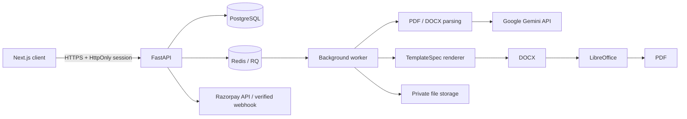

# Architecture

The frontend never calls Gemini or Razorpay secrets directly. Prices and entitlements come from `backend/app/core/packages.py`. Resume uploads are private and keyed by opaque server-generated names. User-owned resources are queried with both resource and authenticated user IDs. Background processing persists state in PostgreSQL; queueing is separate from job status. Template specs and role rubrics are initially seeded from declarative JSON files; the admin-editable versions are persisted in the database.

## Data model
`users`, `user_sessions`, `otp_codes`, `orders`, `payments`, `resumes`, `extractions`, `reviews`, `templates`, `role_rubrics`, `outputs`, `revision_requests`, `testimonials`, `audit_log`, and `webhook_events`. Foreign keys connect orders and resumes to users, output/review/extraction records to resumes, and payments to orders. `webhook_events.event_id` is unique for idempotency. `orders.razorpay_order_id` and `payments.provider_payment_id` are unique where present.

## Trust boundaries
- Resume files, extracted text, filenames, model outputs, and browser form fields are untrusted.
- Gemini output must validate against Pydantic schemas.
- Browser checkout responses are not enough to mark an order paid; the server verifies the signature and fetches provider payment state. Verified capture webhooks can also mark payment paid.
- Administrator endpoints re-check the role on the server.
- Example resume data is used only for template tests and is not production customer data.
